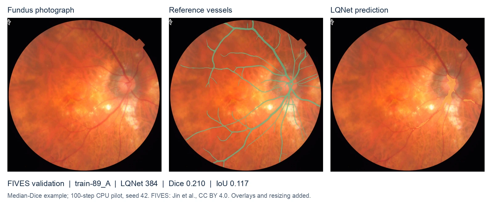
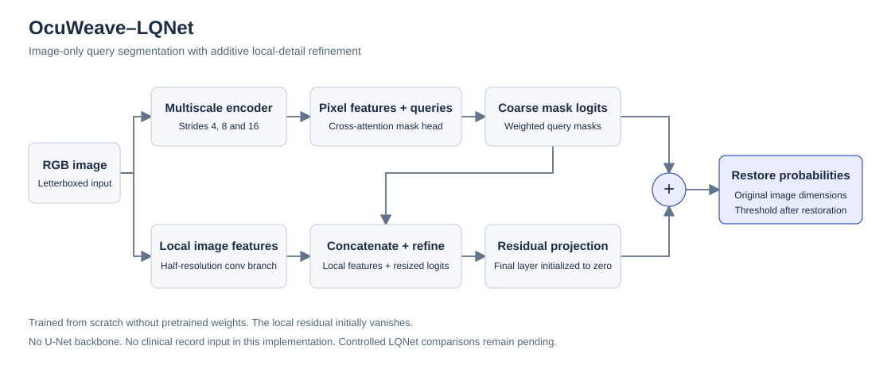

<div align="center">

# OcuWeave

### Evidence-Grounded Vision–Language Learning with Incomplete Clinical Records for Ophthalmic Disease Assessment

**Marchel Andrian Shevchenko** · Data Sorcerers · 2026

[Research page](https://data-sorcerers.com/ocuweave/) · [Getting started](docs/getting-started.md) · [Method](docs/architecture.md) · [Results](docs/results/README.md) · [Changelog](CHANGELOG.md)

[](https://github.com/chenko-the-sorcerers/ocuweave/actions)
[](LICENSE)
[](https://github.com/chenko-the-sorcerers/ocuweave/tree/v0.12.0)



</div>

*A real FIVES validation example selected at the median LQNet Dice. Green: dataset reference; amber: model prediction. The short CPU pilot misses substantial vessel extent. Images and masks: Jin et al., [FIVES v1](https://doi.org/10.6084/m9.figshare.19688169.v1), CC BY 4.0; display resizing and overlays added. [Figure provenance](docs/assets/fives-lqnet-feasibility.json).*

OcuWeave is an open research toolkit for ophthalmic segmentation, with ocular toxoplasmosis as its first experimental task. **OcuWeave–LQNet** adds a local-detail residual branch to our compact query segmenter. Both networks are independently implemented and initialized from random weights. The historical Python backend uses PyTorch; the new native backend implements its own operators and analytic backward in C++/CUDA.

The release provides runnable segmentation workflows for **OTFID, FIVES and IDRiD**, including resumable training, validation and inference. Experimental note/structured-data conditioning modules are implemented and tested on synthetic inputs. They are not a trained LLM–EMR system; longitudinal prediction remains a research direction. The manuscript is in preparation; no conference acceptance or state-of-the-art result is claimed.

## Start here

- **Try the software:** run the synthetic end-to-end demo below; no dataset access or GPU is needed.
- **Reproduce an experiment:** use the [real-data workflow](docs/getting-started.md#real-data-workflow) and [locked development protocol](docs/protocols/exploratory_training.md).
- **Inspect the method:** see [architecture](docs/architecture.md), [equations on the project page](https://data-sorcerers.com/ocuweave/#mathematical-formulation), and the [Python API](docs/api.md).
- **Assess the evidence:** read the [results register](docs/results/README.md), including unsuccessful predictions and unresolved data-quality questions.

## Framework-free native LQNet

The C++17 implementation trains and predicts without PyTorch, TensorFlow, JAX, cuDNN or cuBLAS. It includes analytic backward operators, AdamW, weighted observed-label BCE/soft Dice, checkpoint resume and segmentation area summaries. Optional custom CUDA kernels accelerate convolution/matrix products; other operations remain on the CPU. Image export/evaluation uses Pillow, not an ML framework.

```bash
git clone --branch v0.12.0 https://github.com/chenko-the-sorcerers/ocuweave.git
cd ocuweave
cmake -S . -B build-native -DCMAKE_BUILD_TYPE=Release
cmake --build build-native -j2
ctest --test-dir build-native --output-on-failure
./build-native/ocuweave-lqnet --synthetic true --output outputs/native-demo --width 4 --dim 8 --queries 2 --steps 30
```

[Measured native diagnostic and pending runs](docs/results/native-lqnet-v0120/README.md).

[Native build, data export, controlled experiments and limitations](docs/protocols/native/README.md). Historical Python/PyTorch commands below remain supported; they are a separate backend. Native initialization differs, so new paired native baselines are required. Synthetic demos are not medical benchmarks.

## Historical Python backend installation

Python **3.10+**. Start with CPU; CUDA is optional. C++ tooling is optional, for native confusion counts and weighted pooling. Installation from source is supported; this release is not published to PyPI.

```bash
git clone --branch v0.12.0 https://github.com/chenko-the-sorcerers/ocuweave.git
cd ocuweave
python -m venv .venv
source .venv/bin/activate  # Windows: .venv\Scripts\activate
python -m pip install --upgrade pip
python -m pip install -e ".[research]"
ocuweave --version
```

For a CUDA-specific PyTorch build, install the appropriate PyTorch distribution for your machine before installing the research extra. Google Colab can run these same commands after cloning; mount your own Drive and put persistent outputs there. Hosted notebooks remain optional launchers.

## A complete CPU smoke test

```bash
ocuweave demo --output outputs/demo --device cpu
```

This command generates **24 geometric-shape images**, audits image–mask pairs, trains the small LQNet variant for two epochs, evaluates validation predictions at original dimensions, and saves a checkpoint and prediction. It does not download medical images, access Drive, or evaluate the test split. The synthetic scores are installation checks, not research results.

```text
outputs/demo/
├── shapes.zip                 # Generated fixture, not OTFID data
├── audit/manifest.json        # Frozen fixture split and archive hash
├── config.json
├── example.png / reference.png
├── run/
│   ├── best.pt                # Validation-selected synthetic checkpoint
│   ├── history.json
│   ├── provenance.json
│   └── checkpoint.json
├── validation.json            # Original-grid Dice, IoU and FP analysis
├── prediction/
│   ├── probability.npy        # Float probabilities at original dimensions
│   ├── mask.png               # Threshold 0.5; values 0/255
│   └── prediction.json        # Input/checkpoint hashes and geometry
└── demo.json
```

Run directories are immutable: choose another output path to repeat a run. `python -m ocuweave` is equivalent to `ocuweave`, including after installation from a wheel outside the source checkout.

## Task workflows and diagnostics

```bash
ocuweave doctor
ocuweave demo-tasks --output outputs/task-demo --device cpu
ocuweave demo-multimodal --output outputs/evidence-demo
```

`demo-tasks` generates fixtures in FIVES and IDRiD layouts and exercises preparation, fixed-step training, checkpoint reload, original-grid validation, prediction and training-only diagnostics. `demo-multimodal` checks forward/backward behavior with synthetic notes, structured features and missing modalities. Neither command produces medical evidence.

For real data, follow the [task workflow](docs/task-workflows.md):

| Command | Purpose |
|---|---|
| `prepare-otfid`, `prepare-fives`, `prepare-idrid` | Audit authorized local data and freeze manifests |
| `task-config` | Write an explicit fixed-step configuration |
| `diagnose` | Inspect train-only probability, loss, gradient and parameter-update traces |
| `fit` | Train a task; periodically save model, optimizer, scheduler and RNG states |
| `fit --resume` | Continue an interrupted run into a new output directory |
| `score` | Evaluate validation at original dimensions; preserve the test split |
| `infer` | Export per-class probabilities and masks, optionally with overlapping tiles |

These fixed-step commands form a new protocol. Historical epoch-based commands and frozen feasibility runners remain available. Their configurations and results are not interchangeable.

## Historical OTFID workflow

The following commands assume an **audited local archive and manifest**. Acquisition, patient-identity constraints, cleaning and split review are documented in [Getting started](docs/getting-started.md). They must precede claims about model performance.

```bash
ocuweave init-config --architecture query_detail --size 384 --seed 42 \
  --output outputs/lqnet-384-seed42.json

ocuweave train --manifest data/audit/manifest.json --archive data/otfid.zip \
  --config outputs/lqnet-384-seed42.json --output outputs/lqnet-384-seed42 \
  --device cuda --allow-unverified-patients

ocuweave evaluate --manifest data/audit/manifest.json --archive data/otfid.zip \
  --checkpoint outputs/lqnet-384-seed42/best.pt --output outputs/validation-384.json \
  --device cuda --allow-unverified-patients

ocuweave predict --checkpoint outputs/lqnet-384-seed42/best.pt \
  --image /path/to/fundus.png --output outputs/prediction --device cpu
```

`--allow-unverified-patients` explicitly permits exploratory image grouping; it does **not** verify independence. Omit the flag for a verified patient-group manifest. Evaluation defaults to **validation on the original image grid**. Prediction requires your own checkpoint: no validated pretrained weights are bundled.

## Method at a glance



| Configuration key | Implementation | Parameters at default dimensions | Experimental role |
|---|---|---:|---|
| `query` | [OcuWeaveSegmenter](src/ocuweave/models/segmenter.py) | 109,754 | Query baseline |
| `query_detail` | [LocalDetailSegmenter](src/ocuweave/models/local_detail.py) | 111,411 | LQNet local-detail ablation |
| `fcn` | [CompactFCN](src/ocuweave/baselines/compact_fcn.py) | Reported per run | Encoder/pixel-feature matched baseline |

The local branch starts with a zero output projection. It refines logits at half input resolution. All variants use masked BCE + soft Dice, AdamW, and explicit seed/configuration records. The [model card](docs/model_cards/ocuweave.md) describes scope and limitations.

## Evidence and reproducibility

- One historical OTFID query-network feasibility pilot is documented. Some validation examples have **zero overlap**. These remain reported failures.
- The controlled matrix—query 192, query 384, LQNet 384; seeds 42, 123 and 2026—has **0/9 completed runs** in the recorded research status. This software release does not complete those experiments.
- The new development manifest is frozen at **197 training / 41 validation**, with all **104 quality-flagged images retained** and all 42 historical test rows preserved. CPU smoke checks passed for all three variants. The original session was blocked by Colab limits; T4 became available on 1 November. New training-only diagnostics passed technical checks but failed their small-set fitting criterion, so the main matrix remains pending. See the [execution record](docs/experiments/2026-10-31-development-freeze.md) and [continuation protocol](docs/protocols/exploratory_training.md).
- Supplementary FIVES vessel and IDRiD four-lesion CPU experiments are documented in the [cross-task feasibility report](docs/results/cross-task-feasibility-v0100/README.md). These use 100 steps and one seed; they do not complete the core GPU matrix.
- Clinical annotation correctness and patient linkage remain unresolved. Vessel segmentation does not establish hypertension diagnosis. REFUGE2 disc/cup training remains blocked on dataset access.
- Native C++ now also provides LQNet training/inference, analytic backward, AdamW and custom CUDA convolution/matrix products. Historical Python experiments remain preserved; native results require their own paired baseline.

Training saves configuration, software version, source revision when available, working-tree state, archive/manifest hashes, optimizer-step counts, timing and memory. A wheel without Git metadata records the source revision as unavailable instead of borrowing the caller’s repository. CPU/GPU numerical equality is not guaranteed; preserve the environment and hardware record.

### Supplementary validation results

| Dataset | Query 192 | Query 384 | LQNet 384 |
|---|---:|---:|---:|
| FIVES image-macro Dice | 0.1610 | 0.1985 | 0.2022 |
| IDRiD mean class-positive Dice | 0.0000 | 0.0000 | 0.0000 |

Each is a separate 100-step CPU run, seed 42, evaluated at original image dimensions. FIVES includes one empty reference among 120 validation images; positive-only scores and centerline metrics are in the report. IDRiD predicts background on all annotated validation channels at threshold 0.5. This is an observed failure, not a missing result. The small FIVES Dice difference does not establish superiority; thin-centerline recall did not improve. [Protocols, denominators, time, memory and per-image results](docs/results/cross-task-feasibility-v0100/README.md).

Before main training, complete the [GPU readiness checklist](docs/protocols/gpu_pretraining_diagnostics.md): tensor review, CUDA smoke checks, fixed-subset fitting and background-prediction diagnostics. Patch sampling and loss changes require separate registered comparisons. The `diagnose` command now implements the small-subset diagnostics. Medical-data GPU checks have now run on four IDRiD and four FIVES training images. Technical checks passed, but both tasks failed the predeclared small-set fitting goal; [read the diagnostic findings](docs/results/gpu-readiness-v0110/README.md).

## Cross-task experiment programme

A [prespecified programme](docs/protocols/cross_task_experiments.md) covers OTFID, FIVES vessels, IDRiD lesions and REFUGE2 disc/cup: 36 core designs (including the existing nine OTFID runs) plus nine conditional objective ablations. Seven clean/corrupted evaluation conditions reuse each core checkpoint. The core designs remain unexecuted; FIVES and IDRiD have separately measured supplementary feasibility runs, adapters and inference workflows. REFUGE2 access and task-specific objective ablations remain pending.

```bash
PYTHONPATH=src python scripts/prepare_cross_task_experiments.py --output outputs/cross-task-design-v1
```

The generator writes a non-executable JSON/CSV register with missing metrics as null and preserves existing output directories. It never starts training.

## Data boundaries

| Dataset | Current or intended role | Constraint |
|---|---|---|
| OTFID v3 | Binary toxoplasmosis lesion pilot | No verified paired narrative EMR; patient identities unresolved |
| FairVLMed | Separate glaucoma image–text research | Original-note diagnosis and temporal leakage review required |
| BRSET | Fundus and structured clinical variables | Credentialed access; metadata are not complete narrative records |
| OLIVES / GRAPE | Compatible longitudinal ophthalmic tasks | Different cohorts and endpoints; no automatic time-to-blindness target |
| FIVES | Vessel segmentation feasibility | Provisional similarity groups; test claims barred |
| IDRiD | Four lesion channels | Missing masks excluded; mirror provenance documented |
| REFUGE2 / RETA / PAPILA | Planned or candidate anatomical extensions | Separate annotations, access review and experiments required |

Never combine unrelated patients across datasets. Dataset licenses and access conditions are independent of the code license. The README includes one explicitly attributed CC BY FIVES display figure. Raw dataset archives, clinical notes and third-party model weights are not committed. See [dataset cards](docs/dataset_cards/README.md).

## Repository guide

| Directory | Responsibility |
|---|---|
| `src/ocuweave/data/` | Adapters, paired geometry, grouping and audit modules |
| `src/ocuweave/models/` | Encoder, query head, LQNet and architecture registry |
| `src/ocuweave/training/` | Training/checkpoints and controlled experiment runners |
| `src/ocuweave/evaluation/` | Metrics, original-grid restoration and diagnostics |
| `src/ocuweave/inference/` | Checkpoint-to-image prediction and artifact export |
| `native/` | Optional C++17 confusion counts and numerical pooling |
| `configs/`, `scripts/`, `notebooks/` | Research recipes, advanced entry points and Colab launchers |
| `tests/` | Geometry, metrics, gradients, CLI round trips and native parity |
| `docs/`, `paper/` | Protocols, results, model cards and manuscript source |

Clinical/language/fusion modules implement train-only feature normalization, a randomly initialized byte Transformer and availability-masked conditioning. They have synthetic contract tests, not clinical training or evaluation. See [API and extension boundaries](docs/api.md).

## Development

```bash
python -m unittest discover -s tests -v
cmake -S . -B build -DBUILD_TESTING=ON
cmake --build build
ctest --test-dir build --output-on-failure
```

Set `OCUWEAVE_NATIVE_LIBRARY` to the absolute shared-library path to include Python/native parity checks (`build/libocuweave_native.so` on Linux; `.dylib` on macOS). The [CI workflow](.github/workflows/ci.yml) checks native/Python behavior and runs the public CLI from an installed wheel outside the checkout.

Contributions should include a reproducible issue, a small scoped change and relevant checks. Describe the data license and provenance for any proposed dataset integration; do not submit patient data or checkpoints in a pull request. See [CONTRIBUTING](CONTRIBUTING.md) and [release procedure](docs/protocols/releases.md).

## FIVES vessel experiments

Prepare the official extracted FIVES release and run a supplementary feasibility comparison:

```bash
python scripts/run_fives.py prepare --root /path/to/fives --manifest /path/to/new-manifest.json
python scripts/run_fives.py pilot --root /path/to/fives --manifest /path/to/new-manifest.json --output /path/to/new-run --device cpu --steps 100
```

This compares Query 192, Query 384 and LQNet 384 using seed 42 and equal budgets. It saves final checkpoints, original-grid validation masks, Dice/IoU, centerline metrics and selected examples. It does not complete the separate 500-step GPU programme. Official test images are not evaluated. Patient identity remains unverified; read the [feasibility protocol](docs/protocols/fives_feasibility.md).

## IDRiD lesion experiments

Use the original segmentation subset, keeping the four lesion annotations separate:

```bash
python scripts/run_idrid.py prepare --root /path/to/idrid --manifest /path/to/new-idrid-manifest.json
python scripts/run_idrid.py pilot --root /path/to/idrid --manifest /path/to/new-idrid-manifest.json --output /path/to/new-idrid-run --device cpu --steps 100
```

The four heads predict microaneurysms, haemorrhages, hard exudates and soft exudates. Unavailable masks are excluded from supervision and evaluation. Read the [source and missing-annotation policy](docs/protocols/idrid_feasibility.md) before use. Both feasibility runners require the research dependencies and an extracted dataset; they do not download data implicitly.

Predict four lesion channels from a trained IDRiD checkpoint:

```bash
python scripts/predict_idrid.py --checkpoint /path/to/run/lqnet384/final.pt \
  --image /path/to/fundus.jpg --output /path/to/new-prediction --device cpu
```

This saves four original-size binary masks and a provenance receipt. Add `--save-probabilities` for the float probability array. The installed `ocuweave infer` command also handles IDRiD and FIVES checkpoints; legacy `ocuweave predict` remains binary-only.

## Citation and license

Please cite the **software** until a paper is publicly available. GitHub’s “Cite this repository” uses [CITATION.cff](CITATION.cff).

```bibtex
@software{shevchenko2026ocuweave,
  author = {Shevchenko, Marchel Andrian},
  title = {OcuWeave: Evidence-Grounded Vision--Language Learning with
           Incomplete Clinical Records for Ophthalmic Disease Assessment},
  year = {2026},
  version = {0.12.0},
  url = {https://github.com/chenko-the-sorcerers/ocuweave}
}
```

Original code: [MIT](LICENSE). Research use only; the software is not validated for patient care. Version numbers track software changes, not diagnostic quality or clinical approval.
