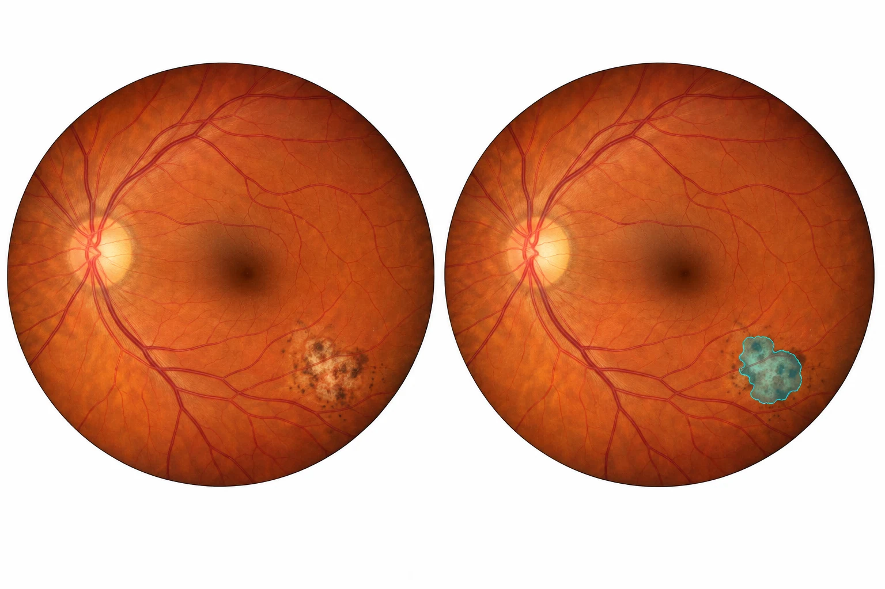

# OcuWeave

**Evidence-Grounded Vision–Language Learning with Incomplete Clinical Records for Ophthalmic Disease Assessment**

**Marchel Andrian Shevchenko** · Data Sorcerers · **2026**

[Project page](https://data-sorcerers.com/ocuweave/) · [Architecture](docs/architecture.md) · [Dataset cards](docs/dataset_cards/README.md) · [Changelog](CHANGELOG.md) · [Citation](CITATION.cff)



*Left: synthetic fundus image. Right: illustrative lesion segmentation. AI-generated educational artwork, not patient data, ground-truth annotation, or an OcuWeave prediction.*

An open research project by **Data Sorcerers**, investigating how retinal images,
clinical notes, and structured clinical information can be combined when evidence
is incomplete or inconsistent. Ocular toxoplasmosis is a focus of the research agenda.

## Paper

**Manuscript in preparation.** The project page reserves a Download paper button; it will become active when a public PDF is available. No paper, DOI, submission, or conference acceptance is claimed.

## Current status

**Experimental segmentation implementation.** OTFID acquisition, source auditing,
conservative duplicate grouping, frozen exploratory splits, a compact non-U-Net
query segmenter, and an encoder/pixel-decoder matched FCN ablation are implemented.
Training, held-out evaluation, and image inference use explicit provenance.
Paired EMR fusion, longitudinal prognosis, and clinical validation remain future work.
No pretrained weights are bundled and no state-of-the-art performance is claimed.

[Open the Colab pilot](https://colab.research.google.com/github/chenko-the-sorcerers/ocuweave/blob/v0.2.0/notebooks/OcuWeave_OTFID_Colab.ipynb)
· [Pilot protocol](docs/protocols/otfid_pilot.md)

The [quality-review notebook](https://colab.research.google.com/github/chenko-the-sorcerers/ocuweave/blob/v0.3.0/notebooks/OcuWeave_Quality_Review_Colab.ipynb)
runs on CPU and audits FairVLMed numeric images and development-note flags, then
diagnoses frozen OTFID checkpoints on training/validation only.
See the [quality-review protocol](docs/protocols/quality_review.md) for scope and limitations.

## Results and controlled development

The [results register](docs/results/README.md) documents completed data audits,
pilot training, validation/test metrics, known failures and unresolved questions.
The [resolution/detail protocol](docs/protocols/resolution_detail.md) separates
resolution changes from the experimental local-detail branch across three seeds.
Original-grid evaluation keeps the comparison geometry fixed. Implementation is
not evidence that the new branch improves performance.

[Open the development notebook](https://colab.research.google.com/github/chenko-the-sorcerers/ocuweave/blob/v0.4.0/notebooks/OcuWeave_Development_Colab.ipynb).
The notebook archives all reports in Drive and records pending runs explicitly
when GPU resources are unavailable. The [EMR gate](docs/protocols/emr_leakage_gate.md)
keeps FairVLMed glaucoma research separate from OTFID toxoplasmosis.

## Quick start

Python 3.10+; CMake 3.20+ and a C++17 compiler for the optional native example.

```sh
python -m venv .venv
# Activate the virtual environment for your operating system.
python -m pip install -e ".[research]"
python scripts/audit_data.py examples/synthetic_manifest.json
python scripts/prepare_data.py examples/synthetic_manifest.json --output outputs/audited_manifest.json
python -m unittest discover -s tests -v
```

The example manifest contains fabricated identifiers and placeholder image paths;
it contains no patient data. For real data, use `audit_data.py --check-files` with
`--data-root` pointing to the authorized local dataset directory.

```sh
cmake -S . -B build -DBUILD_TESTING=ON
cmake --build build
ctest --test-dir build --output-on-failure
python scripts/benchmark_ops.py --library build/libocuweave_native.dylib
```

On Linux use `build/libocuweave_native.so`; on Windows locate
`ocuweave_native.dll` in the build output. For Python/native parity tests, set
`OCUWEAVE_NATIVE_LIBRARY` to the absolute library path before running unittest.
The CPU operator is a numerical interoperability example, not the proposed fusion
algorithm. It has no autograd integration and must not be used as a differentiable
training operator. CUDA kernels are not implemented yet.

For the full image-only experiment, run the version-pinned Colab notebook above.
It downloads the archive directly to Drive, runs tests, creates an audit, and saves
checkpoints and evaluation JSON to Drive. No local Mac GPU or dataset copy is needed.
Use `scripts/train.py --help`, `scripts/evaluate.py --help`, and
`scripts/predict.py --help` for local command-line equivalents. Python uses PyTorch
for autograd; the original model code is in `src/ocuweave/models`.

## Research direction

- Visual representations for full retinal images and lesion regions.
- Clinical representations that preserve text evidence and missingness.
- A proposed evidence-alignment and reliability-aware fusion method.
- Evaluation against image-only, text-only, tabular, and late-fusion baselines.
- Separate evaluation of prediction, localization, calibration, and robustness.

See [architecture](docs/architecture.md), [evaluation protocol](docs/protocols/evaluation.md),
[dataset cards](docs/dataset_cards/README.md), and [model card](docs/model_cards/ocuweave.md).

## Dataset plan

| Dataset | Intended role | Important boundary |
|---|---|---|
| Harvard-FairVLMed | Paired SLO images and original clinical notes | Glaucoma; notes can contain the target diagnosis. Audit leakage first. |
| BRSET | Color fundus + limited EMR-derived metadata | Scar (toxoplasmosis) labels do not establish active infection. Credentialed access. |
| OTFID v3 | Toxoplasmosis lesion classification/segmentation | No paired narrative EMR verified; patient grouping requires inspection. |
| OLIVES | OCT/near-IR imaging and longitudinal clinical measurements | Not a full narrative EMR or a toxoplasmosis cohort. |
| mBRSET | External evaluation on compatible DR endpoints | Different camera/cohort; not an active-toxoplasmosis benchmark. |

Never pair an image with another dataset's patient record. Text generated from
metadata is synthetic/serialized metadata, not an original clinical note.

## Repository map

- `configs/`: dataset, model, experiment, and ablation TOML specifications and JSON pilot configurations.
- `src/ocuweave/`: Python data/model contracts, reference operators, and audit logic.
- `native/`: C++17 operator, C ABI binding, and optional future CUDA kernels.
- `scripts/`: explicit research entry points.
- `tests/`: data integrity, model contracts, and native/reference parity.
- `paper/`: manuscript, figures, and tables for future research outputs.
- `data/`, `outputs/`: ignored local data and generated artifacts.

The directory READMEs describe unimplemented modules without pretending that the
method already exists. Experiments must record patient splits, seed, code revision,
configuration, data provenance, and checkpoint origin.

## Public release and licensing

Original code in this repository is MIT licensed. Dataset and pretrained-weight
licenses remain separate. No patient images, clinical notes, or third-party weights
are redistributed. Public checkpoints are a goal, conditional on upstream terms
and appropriate privacy review. This software is for research, not patient care.

## Versioning

The current software version is **0.4.1**. Changes are recorded in [CHANGELOG.md](CHANGELOG.md), and releases use annotated Git tags (`vMAJOR.MINOR.PATCH`). During `0.x`, interfaces may evolve; pin a tag or commit for reproducible experiments.

Software versions describe implementation changes, not clinical validation or model quality. Dataset versions, configurations, and future checkpoint versions must be recorded independently. See [the release procedure](docs/protocols/releases.md).

## Reference implementations

- [FairCLIP (CVPR 2024)](https://github.com/Harvard-Ophthalmology-AI-Lab/FairCLIP)
- [RETFound](https://github.com/rmaphoh/RETFound)
- [EyeCLIP](https://github.com/Michi-3000/EyeCLIP)
- [FlashAttention](https://github.com/Dao-AILab/flash-attention)

These are research references; no upstream implementation or checkpoint is vendored.
See `CITATION.cff` to cite this research software; no publication acceptance is claimed.

## Cleaning review

Run the CPU [cleaning notebook](https://colab.research.google.com/github/chenko-the-sorcerers/ocuweave/blob/v0.5.0/notebooks/OcuWeave_Cleaning_Review_Colab.ipynb) with the acquired datasets in the private project Drive. The [protocol](docs/protocols/cleaning_review.md) distinguishes technical flags, clinical adjudication, patient linkage and original-note leakage review. No automated exclusion or clinical clearance is performed.

[Observed cleaning results](docs/results/cleaning-review.md): one OTFID train–validation near-duplicate candidate remains unresolved. Technical screening does not verify patient independence, clinical mask correctness or EMR leakage clearance.
