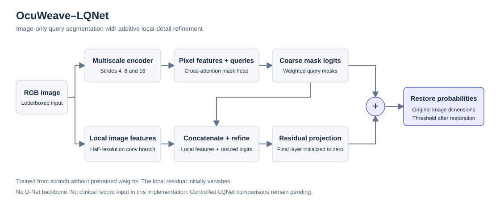

# OcuWeave–LQNet

The implemented method is an image-only query segmenter with an optional local-detail residual. The architecture, training loops, adapters and evaluators are implemented in this repository. PyTorch provides tensor operations and automatic differentiation; the experiments initialize network weights randomly.

## Shared visual representation

`CompactEncoder` produces feature maps at strides 4, 8 and 16. A stride-four RGB stem is followed by depthwise 7×7 spatial mixing, GroupNorm, pointwise channel mixing and a learned residual scale. Default stage widths are 24, 48 and 96.

`PyramidPixels` projects each scale to 48 channels, bilinearly aligns the maps to the stride-four grid, concatenates them and mixes them through a pointwise projection. The coarsest projected map also supplies context tokens.

## Query masks

`QueryMaskHead` maintains eight learned 48-dimensional queries. Four-head cross-attention conditions them on context tokens. Normalized query embeddings interact with the pixel grid through scaled dot products. Learned softmax query weights combine the eight mask logits into one output, followed by a learned scalar bias and bilinear restoration to the input size. These are soft query mixtures; no instance-level Hungarian matching is used.

`OcuWeaveSegmenter` supplies one binary channel for the OTFID and FIVES tasks. The evidence-token argument also supports the experimental composition described below; no clinical multimodal performance has been established.

## Local-detail residual

`LocalDetailSegmenter` adds a stride-two RGB convolution, depthwise spatial filtering and pointwise refinement. The refinement consumes local features together with the resized query logits. Its output projection starts at zero, so the initial residual is exactly zero. The final logit is the query logit plus the restored local residual. The branch adds parameters and compute; improvement must be measured rather than presumed.

## Four lesion channels

`MultiLabelLQNet` shares the visual encoder across four independent query heads for IDRiD: microaneurysms, haemorrhages, hard exudates and soft exudates. Each head owns its pixel projections and attention parameters. The optional shared local branch receives four coarse logits and emits four residuals. Outputs are independent sigmoid channels, not mutually exclusive softmax classes.

The IDRiD loss selects only annotated image–class pairs before computing masked BCE plus soft Dice. Absent annotation files are unknown supervision. Their placeholders contribute neither loss nor gradient. TIFF palette indices are decoded as labels, independently of the colors used to display them.

## Data and evaluation boundaries

- Adapters parse files, verify pair geometry and produce manifests. Models do not select splits or open clinical tables.
- Ground-truth masks are supervision and never model inputs. Paired image–mask augmentation preserves alignment; padding is excluded from the loss.
- Feasibility studies fix the final optimizer step in advance. The older OTFID pilot used validation-selected checkpoints; these policies must not be conflated.
- Evaluation restores probabilities to each original image grid before a fixed 0.5 threshold. Report empty-reference conventions and positive-image denominators.
- File hashes, source revision, seed, actual step count, checkpoint hash and resource scope accompany each run. Provisional similarity groups do not verify patient identity.

## Experimental evidence conditioning

`OcuWeave` composes LQNet with `NoteEncoder`, `ClinicalEncoder` and `EvidenceFusion`. Notes are UTF-8 byte IDs processed by a randomly initialized Transformer and masked mean pooling. Structured features use training-only mean/scale buffers, explicit observed-feature indicators and an MLP. Two availability-masked tokens condition the visual queries through the existing attention interface. Missing payloads are removed before arithmetic and attention. All-missing inputs reduce to image-only segmentation.

This implementation supports synthetic forward/backward tests. It is not an LLM, a trained clinical model, a longitudinal system or validated evidence attribution. Real paired data require separate temporal and target-leakage review. A note can contain information not visible in a photograph.

## Native operations

The optional C++17 library supplies weighted pooling and binary confusion counts through an exception-safe C ABI. Python bindings derive Dice and IoU from native counts. There is no autograd or custom CUDA operator. Neural-network training uses Python/PyTorch; no native performance advantage is asserted.
