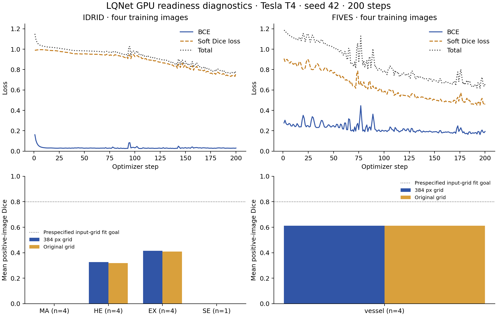

# GPU readiness diagnostics — 1 November 2026

**Decision: technical execution passed; main training is not ready.** Two fixed-budget LQNet diagnostics ran on a Tesla T4 using four training images per task. Both failed the prespecified small-set fitting goal. These are training scores, not validation results or evidence of generalization.

## Registered contract

Source: [`0a855b2` / v0.11.0](https://github.com/chenko-the-sorcerers/ocuweave/tree/0a855b2ade86473c84b60d8e59221ba667e642ba), clean checkout. Seed 42; float32; 384 px; random initialization; 200 AdamW steps; learning rate 0.001; weight decay 0.0001; observed-label BCE + soft Dice; threshold 0.5; no augmentation. The fixed subset is selected from training only using lexical positive-class coverage, then lexical fill. No predictions or held-out metrics informed selection.

- IDRiD: `IDRiD_01`, `IDRiD_03`, `IDRiD_02`, `IDRiD_04`. All four classes are positively supervised, but SE has only one annotated positive image.
- FIVES: `train-101_A` through `train-104_A`. This lexical subset is not balanced across disease groups.
- Small-set fitting goal, declared before fitting: each positively supervised class must reach mean input-grid Dice ≥0.80 within the fixed budget. This is an engineering diagnostic criterion, not a clinical standard.

Full [contract](contract.json), [configuration](config.json), [environment](environment.json), [selection](selection.json), [source manifests](../cross-task-feasibility-v0100/README.md) and [actual session source](reproduce-session.py) are retained. The session script assumes a fresh Colab runtime with authorized Drive access; it is not a public data downloader.

## Measured training-only results

| Task / class | Positive training images | Input-grid Dice | Original-grid Dice | Original-grid IoU |
|---|---:|---:|---:|---:|
| IDRID / MA | 4 | 0.0000 | 0.0000 | 0.0000 |
| IDRID / HE | 4 | 0.3270 | 0.3192 | 0.2062 |
| IDRID / EX | 4 | 0.4148 | 0.4100 | 0.2767 |
| IDRID / SE | 1 | 0.0000 | 0.0000 | 0.0000 |
| FIVES / vessel | 4 | 0.6117 | 0.6115 | 0.4404 |

All metrics are image-macro averages over selected positive, annotated image–class pairs. Missing annotations are excluded. Original-grid probabilities are restored before thresholding. Saved binary masks were independently recounted and matched TP/FP/FN and Dice exactly. No validation or test image was evaluated.

These values must not be compared as improvements over the earlier 100-step CPU **validation** table: the cohort, budget, device and evaluation split differ. The previous validation results remain unchanged.

## What the diagnostics establish

Both tasks have finite losses and nonzero aggregate gradients/parameter updates in every recorded model group. Checkpoint reload matches. Technical success does not mean the model learned each lesion.

| Task | Loss, first → final step | Diagnostic duration | Peak CUDA allocated |
|---|---:|---:|---:|
| IDRID | 1.1504 → 0.7947 | 22.68 s | 448.54 MiB |
| FIVES | 1.1847 → 0.6578 | 12.98 s | 271.18 MiB |

Duration includes diagnostic fitting, checkpoint reload, probability summaries, original-grid measurement and artifact writes. It is not a controlled throughput benchmark. Peak allocated/reserved memory is retained in each report.

MA and SE have TP=FP=0 on the selected original-grid training masks. Their image-mean probabilities on foreground pixels at the input grid are approximately 2.34×10⁻⁶ and 5.82×10⁻⁷, respectively. HE and EX produce nonzero overlap, but remain below the fitting goal. FIVES learns partial vessel extent and also falls short. Loss reduction alone would therefore have been a misleading readiness signal.

## Geometry-only experiment

Reference labels were resized with nearest-neighbor interpolation to 192/384 px, then restored with the evaluator’s bilinear interpolation and threshold 0.5. This measures a particular label roundtrip; it is **not a mathematical upper bound** on model performance.

| Class | 192 px roundtrip Dice | 384 px roundtrip Dice |
|---|---:|---:|
| IDRID / MA | 0.4536 | 0.7181 |
| IDRID / HE | 0.7860 | 0.8979 |
| IDRID / EX | 0.5814 | 0.7833 |
| IDRID / SE | 0.8102 | 0.9316 |
| FIVES / vessel | 0.8252 | 0.9168 |

`IDRiD_04` MA contains 804 original positive pixels, reduced to 1 at 192 px and 6 at 384 px. These are pixel counts, not lesion counts. The SE reference in `IDRiD_03` retains roundtrip Dice 0.9316 at 384 px while its model prediction is empty. Thus resize/restoration alone does not explain the complete MA/SE failure. Foreground imbalance, optimization, representation and budget remain competing hypotheses.

Technical overlays were inspected for all eight selected images at 384 px; no gross displacement was visible at that scale. This does not certify clinical boundaries or annotation completeness. Quality-flagged images were not excluded; patient identity remains unverified.

## Registered next experiment — not executed

Change the objective alone: positive-weighted observed BCE plus the unchanged soft-Dice component. Derive weights from the 43 IDRiD training images at 384 px, excluding padding and missing annotations: `w_c = clip(sqrt(N_negative / N_positive), 1, 20)`. Hold selected images, architecture, seed, resolution, optimizer, learning rate, 200-step budget and threshold fixed. Implement and gradient-test the weighted objective before execution.

| Class | Annotated training images | Positive pixels | Negative pixels | Fixed positive weight |
|---|---:|---:|---:|---:|
| MA | 43 | 4,576 | 4,205,984 | 20.000000 |
| HE | 42 | 29,992 | 4,082,648 | 11.667243 |
| EX | 43 | 28,952 | 4,181,608 | 12.018005 |
| SE | 21 | 6,878 | 2,049,442 | 17.261826 |

The weight rule and one follow-up comparison are now [registered](next-loss-comparison.json). Its score is not known. Patch sampling, higher resolution and architecture changes require separate controls; they are not folded into this objective comparison. The nine-run OTFID suite and 45-run core programme remain uncompleted.

## Evidence and preservation

- [Readiness decision](readiness-decision.json), [class/gate summary](summary.json), [CUDA smoke checks](cuda-smoke.json).
- [IDRiD full report](idrid/diagnostics.json) and [200-step history](idrid/history.json).
- [FIVES full report](fives/diagnostics.json) and [200-step history](fives/history.json).
- [Per-image roundtrip records](label-roundtrip.json), [pixel counts and missingness](geometry.json), [technical visual-review scope](technical-review.json).
- Private Drive session: `OcuWeave — Datasets and experiments/04 — Runs/GPU-readiness-v0.11.0/20261101T044150Z`. Checkpoints, full-resolution reference/prediction masks, tensor overlays and a standalone notebook remain there.
- [Executed Colab session](https://colab.research.google.com/drive/1sWC5fmk-sVvDVjskL4IsoA7wuk6uAY2R#scrollTo=odSusXJRbtbG). Only the newly appended diagnostic section was executed in the fresh GPU runtime; historical cells were preserved.
- Export ZIP SHA256: `2665ac3edc9dc50e385a538b1f8d4f09d726f1585c28a81d8c1922d0cfd3fde6` (287,295 bytes). Raw photographs, full masks and weights are excluded from this public evidence export.

The standalone notebook retains the executed session source and result figure; intermediate outputs remain in sibling JSON files. The source cells ran sequentially in Colab, but the newly assembled notebook was schema-validated rather than rerun, to avoid repeating training. A syntax error in the initial archival cell was corrected; it did not alter either completed diagnostic.
